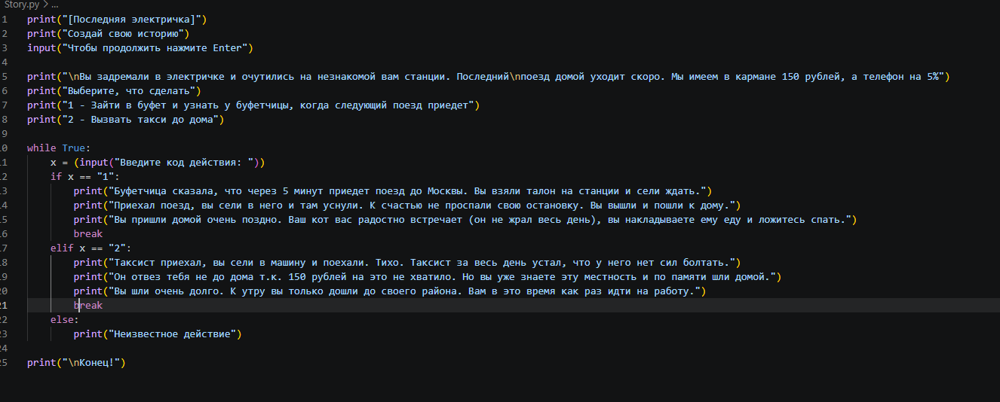
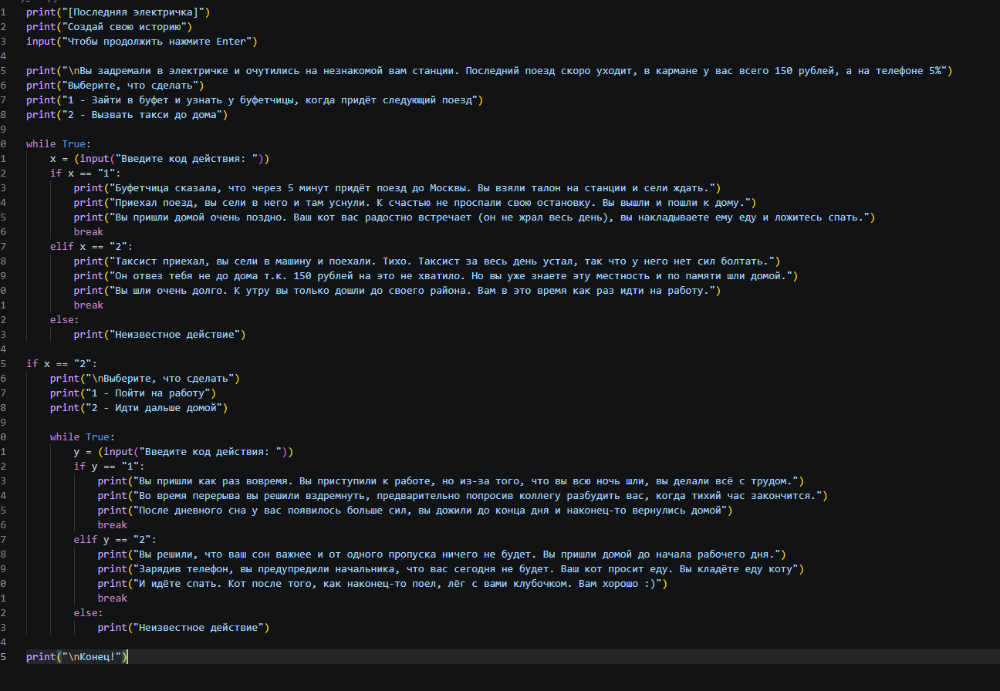
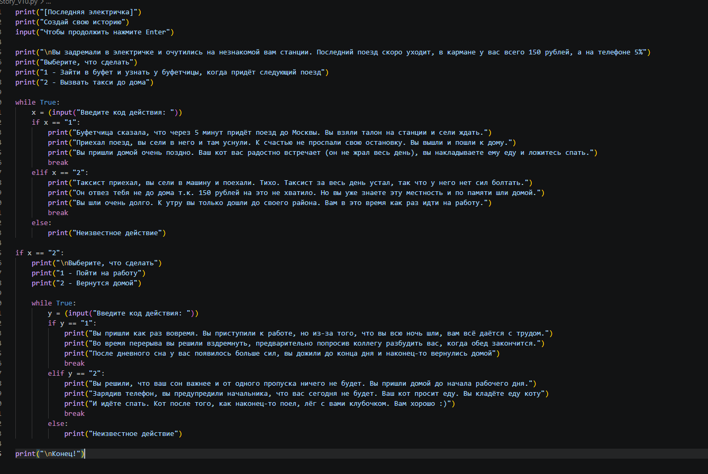

# Отчёт об обновлениях

Как изменялся проект в процессе разработки и обновлений

## v0.1 - начальная версия

- есть начальное меню
- две разные концовки, в которых пермонаж либо возвращается домой, либо оказывается утром на улице.

[Версия 0.1 продукта](Story_v01.py)

## v0.2 - исправленная версия

Во второй версии добавили:
- ещё одну развилку после второй концовки из первой - пойти на работу или нет
- немного исправили текст новеллы.

[Версия 0.2 продукта](Story_v02.py)

## v1.0 - финальная версия

В финальной версии исправили:
- название второго выбора
- текст первой концовки после второй концовки

[Версия 1.0 продукта](Story_v10.py)

## Дефекты, найденные в процессе разработки:
- Текст новеллы (стоило подправить)
- Название выбора