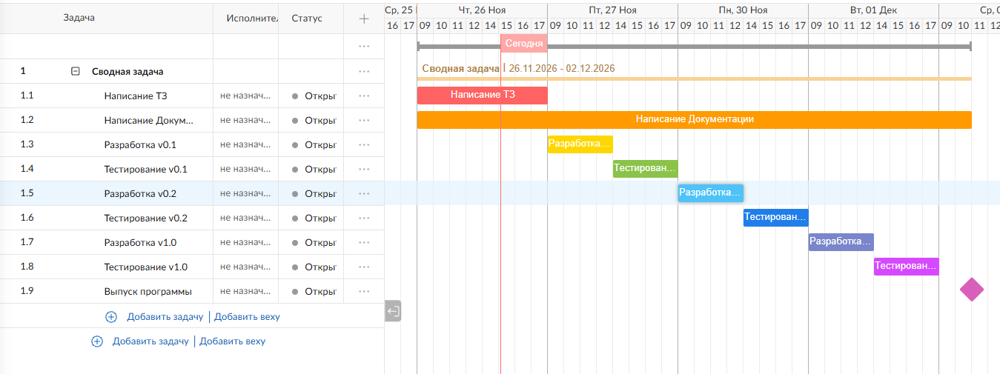

# План проекта

1. Написание ТЗ - Тимофей Аймалетдинов
2. Написание документации - Тимофей Аймалетдинов, Павел Дёгтев, Елена Чулина
3. Разработка v0.1/v0.2/v1/0 - Павел Дёгтев
4. Тестирование v0.1/v0.2/v1/0 - Елена Чулина

## Таблица Ганта

## Риски

1. Программа полностью удалится - делать копии файлов
2. Произойдёт утечка данных - сделать двойное хранение