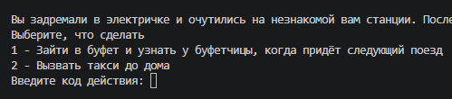

# 04 Техническое задание

## Общее описание

История про человека [его зовут Боб], который задремал в электричке и очнулся ночью на незнакомой станции. Последний поезд скоро уходит, денег всего 150 рублей, телефон почти разряжен. Нужно как-то добраться домой. Чем закончится путь - решает игрок.

Игра написана на Python и запускается в консоли. Игрок видит текст сцены, выбирает действие цифрой 1 или 2 и читает, что из этого вышло.

## Как устроена история

Всего в истории 5 сцен и 3 концовки.

**Сцена 1 - Станция.** Герой просыпается на незнакомой станции. Ему нужно выбрать, что делать дальше. Это первая развилка:

1. **Буфет** - зайти в буфет и спросить у буфетчицы, когда придёт поезд.
2. **Такси** - вызвать такси до дома.

## Что происходит в каждой ветке

**"Ветка «Буфет".** Буфетчица говорит, что через 5 минут придёт поезд до Москвы. Герой берёт талон, садится в поезд и засыпает в пути. Дома оказывается очень поздно, зато кот его встречает. Это концовка №1 - «Домой поздно ночью».

**"Ветка «Такси".** Таксист везёт героя, но 150 рублей хватает не до самого дома. Дальше герой идёт пешком и доходит до своего района только к утру. Тут начинается вторая развилка:

1. **На работу** - пойти на работу как ни в чём не бывало.
2. **Домой** - вернуться домой и отоспаться.

**Ветка "Такси" + "На работу".** Герой приходит вовремя, но после бессонной ночи всё делает с трудом. В обед он спит под присмотром коллеги и дотягивает до конца дня. Это концовка №2 - "Рабочий день после бессонной ночи".

**Ветка "Такси" + "Домой".** Герой решает, что сон важнее. Он приходит домой до начала рабочего дня, предупреждает начальника, кормит кота и ложится спать. Кот ложится с ним рядом. Это концовка №3 - "Дом и кот".